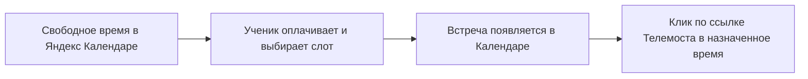
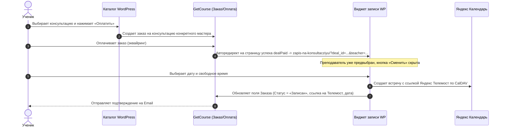

# Руководство по системе консультаций «ЁМКО»

Данный документ содержит две независимые инструкции:
1. **Инструкция для преподавателей** — как вести календарь, управлять расписанием и проводить встречи в Яндекс Телемосте.
2. **Руководство администратора** — архитектура связки WordPress, Яндекс Календаря и GetCourse, добавление преподавателей и решение типовых вопросов.

---

## ЧАСТЬ 1. Памятка преподавателю

> [!NOTE] 
> Ваша работа с консультациями полностью происходит в вашем привычном **Яндекс Календаре** на телефоне или компьютере. Вам не нужно заходить в админку сайта или настраивать сложные системы.



### 1. Как формируется доступное время для учеников
* Сайт автоматически берет ваше рабочее расписание (например, с 14:00 до 22:00 по Москве в согласованные дни недели).
* **Сайт сам проверяет ваш Яндекс Календарь в реальном времени.** Если у вас уже стоит личное дело, встреча или запись — этот час ученик выбрать не сможет.

### 2. Как заблокировать день или время (отпуск, выходной, личные дела)
* Если вам нужно уйти по делам, отдохнуть или закрыть определенные часы — просто **создайте любое событие в вашем Яндекс Календаре** (например, с 15:00 до 18:00 «Занято» или «Обед»).
* Сайт мгновенно скроет эти часы из записи учеников. Накладок не произойдет.

### 3. Что происходит, когда ученик записался
1. В вашем Яндекс Календаре автоматически создается событие (например: *«Консультация: Иван Иванов (Курс / Заказ №...)»*).
2. В описании события указаны:
   * Имя и фамилия ученика;
   * Его контакты (Email, телефон);
   * Запрос к консультации (если ученик оставил комментарий).
3. В событии **уже создана готовая ссылка на видеовстречу Яндекс Телемост**.

### 4. В день и время консультации
1. Откройте событие в вашем Яндекс Календаре (на телефоне или ноутбуке).
2. Нажмите на ссылку **«Подключиться к Телемосту»** (или перейдите по ссылке из описания встречи).
3. В комнату встречи подключится ученик. Проведите консультацию!

> [!TIP]
> Ученику за 1 час до встречи приходит автоматическое напоминание на почту с этой же ссылкой на Яндекс Телемост.

---

## ЧАСТЬ 2. Руководство администратора

### Архитектура и сквозной процесс



---

### 1. Добавление и настройка преподавателя

1. В админке WordPress перейдите в меню: **«Запись ЁМКО»** (или «Консультации»).
2. Во вкладке **«Преподаватели»** нажмите **«+ Добавить преподавателя»**:
   * **ФИО:** например, *Кело Локонте*.
   * **Специализация:** например, *Режиссёр анимации*.
   * **Длительность встречи:** выберите длительность (по умолчанию 60 минут).
   * **Буфер после встречи:** время на перерыв между слотами (например, 10-15 минут).
   * **Привязанный календарь:** выберите конкретный календарь преподавателя из Яндекс Аккаунта (кнопка *«Обновить список календарей»* подтягивает новые календари из Яндекса).
   * **Рабочие дни и часы:** отметьте дни недели и рабочие часы (по московскому времени, UTC+3).
3. Нажмите **«Сохранить преподавателя»**.
4. Скопируйте сгенерированный **ID преподавателя** (например, `teacher_1791476489`).

---

### 2. Защита страницы бронирования (Gate)

* **Адрес страницы записи:** `https://emko.academy/zapis-na-konsultacziyu/`
* **Если человек зашел без оплаты:** виджет определяет отсутствие параметров заказа (`deal_id`) и показывает защитный экран со ссылкой в каталог:
  > *«Выбор даты и времени встречи доступен после выбора преподавателя и оплаты консультации»*  
  > Кнопка ведет на `https://emko.academy/consultations/`.
* **Если человек пришел после оплаты:** виджет пропускает его сразу к календарю выбранного преподавателя со скрытием кнопки «Сменить мастера», а поля имени, email и телефона заполняются автоматически.

---

### 3. Настройка страницы успеха в GetCourse (`dealPaid`)

На системной странице GetCourse `https://course.emko.academy/sales/shop/dealPaid/id/config/hash/`:

1. Размещен скрытый контейнер с переменными заказа (блок «Текст» / «HTML»):
   ```html
   <div id="gc-user-data" style="display:none;" 
        data-email="{email}" 
        data-phone="{phone}" 
        data-name="{first_name}">
   </div>
   ```
2. В блоке JavaScript размещен скрипт редиректа:
   * Он считывает `deal_id` из URL адреса оплаты.
   * Считывает персональные данные ученика из `#gc-user-data` (или резервно из строки «отправлена на почту...»).
   * Определяет ID преподавателя (`teacher_...`) и перенаправляет ученика на `https://emko.academy/zapis-na-konsultacziyu/?deal_id=...&teacher=...&email=...&phone=...&name=...`.

---

### 4. Поля в GetCourse и автоматические рассылки

В GetCourse в разделе **«Продажи» ➔ «Настройки» ➔ «Дополнительные поля заказов»** задействованы поля:
* `Дата и время консультации` (Строка)
* `Преподаватель` (Строка)
* `Ссылка на Телемост` (Строка)
* `Статус консультации` (Строка: `Записан`, `Напомнить`, `Завершена`)

#### Схема процесса в GetCourse:
1. **Письмо №1 (сразу после оплаты):**  
   Если ученик закрыл вкладку оплаты, GetCourse отправляет письмо со ссылкой на страницу записи:  
   `https://emko.academy/zapis-na-konsultacziyu/?deal_id={object.id}&email={email}&teacher={Преподаватель}`.
2. **Письмо №2 (подтверждение записи):**  
   Срабатывает, когда в заказе `Статус консультации == "Записан"`. В письме выводятся `{Дата и время консультации}`, `{Преподаватель}` и кликабельная `{Ссылка на Телемост}`.
3. **Письмо №3 (напоминание за 1 час):**  
   Плагин WordPress ровно за 1 час до слота отправляет хук в GetCourse и переключает `Статус консультации == "Напомнить"`, что запускает триггерное письмо с напоминанием.

---

### 5. Обслуживание и дистрибутив плагина

* Актуальный архив плагина хранится строго в одном месте:  
  📁 `H:\ОБУЧЕНИЕ\ВАЙБКОДИНГ\emko-consultations\dist\emko-consultations.zip`
* Репозиторий GitHub: `https://github.com/getassistant54/emko-consultations` (ветка `main`).
* Обновление плагина на WordPress производится через штатное меню: **«Плагины» ➔ «Добавить новый» ➔ «Загрузить плагин» ➔ «Заменить текущую версию»**.
