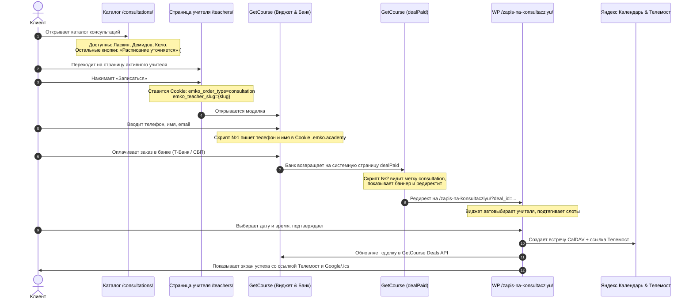

# 📋 Официальный протокол и архитектура интеграции консультаций «ЁМКО»

> **Репозиторий проекта:** `https://github.com/getassistant54/emko-consultations`  
> **Версия протокола:** 1.4.0 (Октябрь 2026)  
> **Статус:** Production Ready

---

## 1. Фундаментальный принцип разделения ответственности

Вся система разделена на **3 изолированных слоя**, которые никогда не должны смешиваться:

```
┌────────────────────────────────────────────────────────────────────────┐
│ 1. GETCOURSE CRM & ЭКВАЙРИНГ (course.emko.academy)                     │
│    - Виджет формы #1628250 (создает заказ / сделку)                    │
│    - Скрипт №1 (Счетчики): автозахват телефона и имени в Cookie        │
│    - Скрипт №2 (Страница dealPaid): авторедирект консультаций на WP    │
└───────────────────────────────────┬────────────────────────────────────┘
                                    │ Redirect после оплаты
                                    ▼
┌────────────────────────────────────────────────────────────────────────┐
│ 2. ЯДРО БРОНИРОВАНИЯ WORDPRESS (emko-booking / emko-consultations)     │
│    - Страница /zapis-na-konsultacziyu/ (шорткод [emko_booking])        │
│    - REST API: /slots, /teachers, /book                                │
│    - CalDAV синхронизация с Яндекс Календарями преподавателей          │
│    - Генерация персональной ссылки Яндекс Телемост                     │
│    - Запись данных в GetCourse Deals API (дата, время, ссылка, статус) │
│    ⚠️ СТРОГОЕ ПРАВИЛО: плагин содержит 0 визуальных хаков сайта!       │
└───────────────────────────────────┬────────────────────────────────────┘
                                    │
┌───────────────────────────────────▼────────────────────────────────────┐
│ 3. МИНИ-ПЛАГИН ВИЗУАЛА (emko-site-tweaks)                              │
│    - Файл: wp-content/plugins/emko-site-tweaks/emko-site-tweaks.php    │
│    - Кнопки «Расписание уточняется» в каталоге /consultations/         │
│    - Ховер-эффект: текст и рамка цвета #C90D7F, прозрачный фон         │
│    - Встраивание iframe GetCourse в модалку #callback_4 на /teachers/  │
└────────────────────────────────────────────────────────────────────────┘
```

---

## 2. Сквозной путь клиента (End-to-End User Journey)



---

## 3. Скрипты GetCourse: Где стоят и как работают

### Скрипт №1: Глобальный автозахват контактов
* **Где размещается:** В панели GetCourse: **Настройки аккаунта ➔ Счетчики** (или настройки тем в блок HEAD).
* **Статус проверки:** ✅ **Уже установлен и работает на боевом сайте!**
* **Код:**
```html
<script>
document.addEventListener('input', function(e) {
    var el = e.target;
    if (!el || !el.value) return;
    var n = ((el.name || '') + ' ' + (el.id || '') + ' ' + (el.className || '')).toLowerCase();
    var t = (el.type || '').toLowerCase();
    var val = el.value.trim();
    if (t === 'tel' || n.indexOf('phone') !== -1) {
        if (val.length >= 7) {
            try { localStorage.setItem('emko_user_phone', val); } catch(err) {}
            document.cookie = 'emko_user_phone=' + encodeURIComponent(val) + '; domain=.emko.academy; path=/; max-age=2592000';
        }
    } else if (n.indexOf('name') !== -1 && n.indexOf('user') === -1) {
        try { localStorage.setItem('emko_user_name', val); } catch(err) {}
        document.cookie = 'emko_user_name=' + encodeURIComponent(val) + '; domain=.emko.academy; path=/; max-age=2592000';
    }
});
</script>
```

---

### Скрипт №2: Авторедирект консультаций со страницы успеха
* **Где размещается:** GetCourse ➔ **Сайт ➔ Страницы ➔ Системные ➔ dealPaid** (Страница «Спасибо за оплату заказа»). Вставляется как блок **Javascript** (`xdget_javascript`).
* **Почему пропал:** На странице `dealPaid` 5 октября стоял рабочий блок `r1701_1_1`. Во время редизайна страницы «Спасибо» 8-9 октября (когда настраивались блоки `.emko-pay-card`) системная страница была пересохранена без этого блока.
* **Логика работы:**
  1. Читает `deal_id` из URL страницы (`/dealPaid/{id}`).
  2. Проверяет наличие Cookie `emko_order_type === 'consultation'`. Если есть — делает редирект мгновенно.
  3. Если клиент платил с другого устройства или инкогнито — делает фоновый `fetch` информации о заказе и ищет слово `консультац`.
  4. **Если это обычный курс — скрипт НЕ вмешивается**, ученик спокойно видит стандартную страницу курса.
* **Код скрипта для блока Javascript на странице dealPaid:**
```html
<script>
(function() {
    var path = window.location.pathname;
    var matchPaid = path.match(/\/dealPaid\/(\d+)/);
    var paidDealId = matchPaid ? matchPaid[1] : null;

    var hashMatch = window.location.search.match(/hash=([^&]+)/);
    var hash = hashMatch ? hashMatch[1] : '';

    if (!paidDealId) return;

    function getStored(key) {
        try {
            var val = localStorage.getItem(key) || sessionStorage.getItem(key);
            if (val) return val;
        } catch(e) {}
        var match = document.cookie.match(new RegExp('(?:^|;\\s*)' + key + '=([^;]+)'));
        return match ? decodeURIComponent(match[1]) : '';
    }

    var orderType = getStored('emko_order_type');
    var checkUrl = '/sales/shop/dealPay/id/' + paidDealId + (hash ? '/hash/' + hash : '');

    function proceedRedirect(email) {
        // Очищаем одноразовую метку консультации
        try { localStorage.removeItem('emko_order_type'); } catch(e) {}
        document.cookie = 'emko_order_type=; domain=.emko.academy; path=/; max-age=0';

        var savedPhone = getStored('emko_user_phone');
        var savedName = getStored('emko_user_name');
        var teacherSlug = getStored('emko_teacher_slug');

        var emailParam = email ? '&email=' + encodeURIComponent(email) : '';
        var phoneParam = savedPhone ? '&phone=' + encodeURIComponent(savedPhone) : '';
        var nameParam = savedName ? '&name=' + encodeURIComponent(savedName) : '';
        var teacherParam = teacherSlug ? '&teacher=' + encodeURIComponent(teacherSlug) : '';

        // Фирменное уведомление перед переходом
        var banner = document.createElement('div');
        banner.style.cssText = 'position:fixed;top:0;left:0;width:100%;background:#83298B;color:#fff;text-align:center;padding:16px;font-size:18px;font-weight:700;z-index:999999;box-shadow:0 4px 15px rgba(0,0,0,0.2);';
        banner.innerText = 'Оплата принята! Перенаправляем на выбор времени консультации...';
        document.body.appendChild(banner);

        setTimeout(function() {
            window.location.href = 'https://emko.academy/zapis-na-konsultacziyu/?deal_id=' + paidDealId + emailParam + phoneParam + nameParam + teacherParam;
        }, 1200);
    }

    if (orderType === 'consultation') {
        proceedRedirect('');
        return;
    }

    // Фоновая проверка по названию предложения для покупок без cookie
    fetch(checkUrl)
        .then(function(res) { return res.text(); })
        .then(function(html) {
            var isConsultation = html.toLowerCase().indexOf('консультац') !== -1;
            if (isConsultation) {
                var emailMatch = html.match(/[\w.-]+@[\w.-]+\.[a-zA-Z]{2,}/);
                var email = emailMatch ? emailMatch[0] : '';
                proceedRedirect(email);
            }
        })
        .catch(function(e) { console.log('Check error:', e); });
})();
</script>
```

---

## 4. Тестирование и отладка (Cheat Sheet)

### Почему при ручном платеже из карточки GetCourse не срабатывает редирект?
* Когда администратор в GetCourse нажимает «Добавить платеж», браузер НЕ проходит через банковский шлюз.
* Ссылка `dealPay` для уже оплаченного заказа открывает профиль/карточку заказа в CRM.
* **Как тестировать корректно:**  
  После добавления платежа в заказе `{deal_id}` откройте в браузере системную страницу успеха этого заказа:  
  `https://course.emko.academy/sales/shop/dealPaid/{deal_id}?hash={hash}`  
  (например: `https://course.emko.academy/sales/shop/dealPaid/906076127?hash=a198`).  
  Скрипт №2 моментально подхватит заказ и перенаправит на `/zapis-na-konsultacziyu/`.

---

## 5. Реестр активных преподавателей

| Преподаватель | Slug на сайте | ID в плагине бронирования | Календарь Яндекс |
|---|---|---|---|
| Кело Локонте | `kelo-lokonte` | `teacher_1791476489` | `/calendars/eminxx%40ya.ru/events-381685793656155/` |
| Дмитрий Демидов | `dmitrij-demidov` | `teacher_1791476728` | `/calendars/eminxx%40ya.ru/events-381685965832239/` |
| Семён Ласкин | `semyon-laskin` | `teacher_1791530901` | `/calendars/eminxx%40ya.ru/events-1469795/` |
